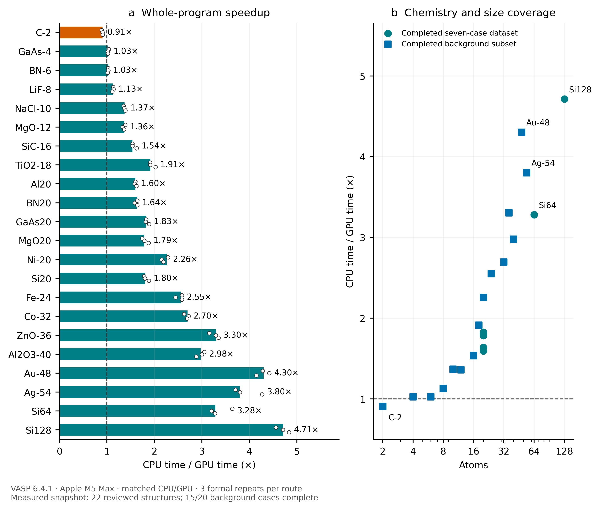
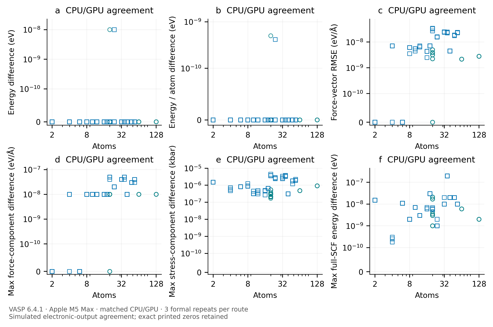
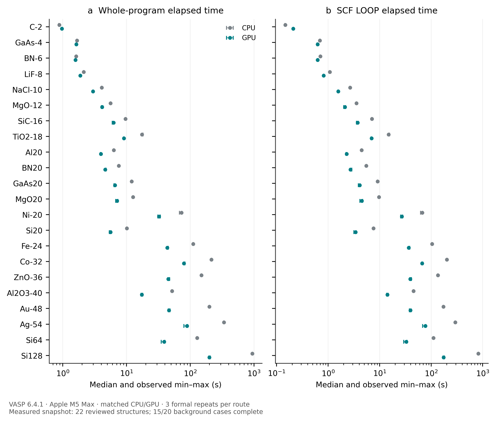
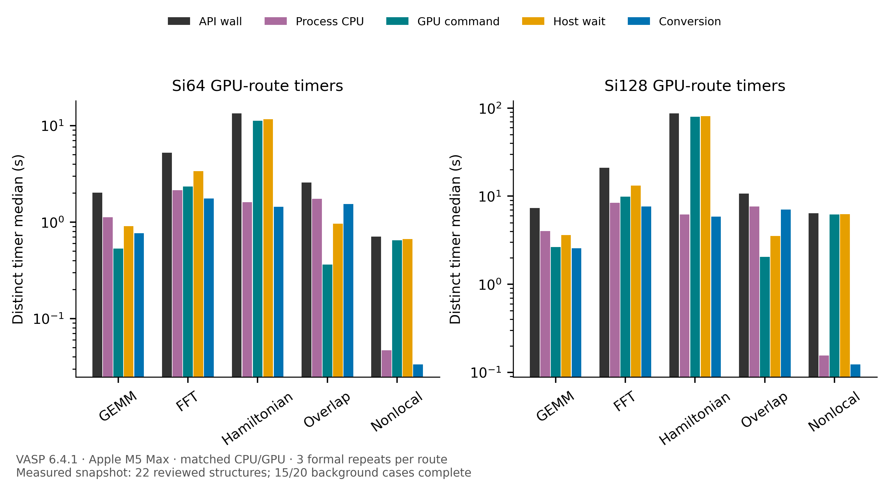

# MetalVASP

[English](README.md) · [用户指南](docs/USER_GUIDE.zh-CN.md) · [技术实现](docs/TECHNICAL.zh-CN.md) · [实测说明](docs/BENCHMARKS.zh-CN.md) · [版权与第三方声明](NOTICE.md)

**为 Apple Silicon 上的合法授权 VASP 提供 Metal 加速。** 本源码发行版包含双单精度计算内核、受预算约束的工作区、可复用的波函数基底，以及限定布局的非局域力/应力投影器。本地安装入口识别设备和工具链，检查 VASP 版本，并在独立副本内准备构建。

**0.15.0-rc4：使用 Apple Silicon GPU 加速本地授权的 VASP。** Si128 相对匹配 CPU 路线实测加速 **4.713×**，总耗时减少 **78.8%**。公开快照覆盖 22 个结构、2–128 个原子，其中包含后台 20 体系测试已完成的 15 个。包内不含 VASP 源码、赝势或 VASP 可执行文件。

## 快速开始

需要 arm64 Mac、macOS 13 或更高版本、Apple 开发工具、Python 3.10+、CMake 3.24+、GNU Fortran、匹配的 Open MPI、LP64 OpenBLAS/ScaLAPACK 和 FFTW。依赖库自身的最低 macOS 版本可能高于 13，详见[兼容性矩阵](docs/COMPATIBILITY.zh-CN.md)。

```sh
# 只读诊断：硬件、SDK、工具和缺失依赖。
./setup.sh doctor --json diagnostics.json

# 交互入口：输入本机合法授权的源码/安装包路径，以及新的工作目录。
./setup.sh

# 检查和规划，不启动编译：
./setup.sh plan --source /path/to/vasp.6.4.1.tgz --json plan.json

# 依次构建所有变体；按性能核心和内存自动选择编译并发数。
./setup.sh build --source /path/to/vasp.6.4.1.tgz --work "$HOME/metalvasp-build" --profile auto

# 在自己具有合法许可的计算目录中运行：
VASP_METAL_STATS="$PWD/metal-stats.json" "$HOME/metalvasp-build/run-metal.sh"
```

源码路径只在本机使用。安装器不上传、不下载 VASP，也不会自动安装依赖。源码/安装包路径可以包含空格；Make 工作目录和依赖路径需要避开空格及展开字符。已有工作目录不会被覆盖。

**已验证的原生适配版本为 VASP 6.4.1。** 所有受影响文件的源码指纹必须匹配，才会应用修改。其他版本会得到检查报告。只有显式开启实验选项，且所有指纹依然一致，才允许尝试其他 6.x 版本。布局改变时需要新增适配器并重新做数值验证，详见[版本适配](docs/COMPATIBILITY.zh-CN.md)。

## 加速范围

| 部分 | 已实现行为 | 范围边界 |
| --- | --- | --- |
| 线性代数 | 复数 GEMM、归约、重叠/子空间操作；GPU 本征求解策略和受预算约束的分块 | LP64 接口；保留 CPU 回退 |
| FFT/局域 Hamiltonian | 批量变换、局域算符内核、复用分配 | ABI 仍有传输；分布式 FFT 尚开放 |
| 波函数基底 | 检查代次的基底复用和增量导入 | 完整 SCF 波函数/PAW/Hamiltonian 常驻生命周期尚开放 |
| 非局域力/应力 | 因子化 radial × phase × wave 投影、共享力导数、64 位逻辑偏移和预算窗口 | 显式启用；std 复数、单 rank/k 点/自旋/spinor、非螺旋布局 |
| 新 Metal 设备 | 按真实设备 family、SDK 和 OS 选择共享 tile 内核及可用 MSL | 没有 ANE/tensor/Metal 4 新 encoder 实现 |

推荐 `auto`。`portable` 使用基线 MSL 和通用 ARM CPU 目标；`advanced` 请求符合条件的 tile 内核，同时保留能力检查和回退。设备名称仅记录信息，不代替真实能力检查。这是依据能力的配置选择，不能保证对任何输入都全局最优。双单精度内核始终采用 safe/precise 数学并关闭隐式收缩。

## 使用 MetalVASP 有什么优势？

- **在 Apple Silicon 上缩短计算时间。** Si64、Au48、Si128 相对 CPU 的整程序加速比分别为 3.282×、4.302×、4.713×。CPU 参考使用单 MPI rank、单 BLAS 线程，这不是与全线程 CPU 配置的比较。
- **保持与 CPU 的电子结构输出一致。** 88 个 CPU/GPU 输入、数值及完整 SCF 对照全部通过。快照内最大能量差为 1.000001×10⁻⁸ eV，最大力分量差为 7.00×10⁻⁸ eV/Å。
- **本地安装并检查设备和源码。** 安装器报告缺失工具、识别真实 Metal 能力，从用户自己的合法源码创建隔离构建。
- **复用数据并控制单算子工作区。** 波基底代次、增量导入和内存预算窗口避免无条件重复导入及过大投影缓冲区。不符合条件的布局保留 CPU 路线。

## GPU 对 CPU 的实测结果

所有图表均比较**本发布版 GPU 路线与 CPU 路线**：输入相同，同一程序启用/关闭 Metal。22 个已审核结构在 Apple M5 Max、VASP 6.4.1、单 MPI rank、单 BLAS 线程下计算。每路线一次预热、三次正式独立计算，共 **176 个所选路线进程、132 个正式计时样本、88 个 CPU/GPU 数值和完整 SCF 对照**。A 数据集含七个完整体系，B 数据集含后台已完成的 15/20 个；运行中或未完成的体系不计入。



GPU 中位耗时在 **21/22** 个结构中更短，实测中位加速比为 **0.908–4.713×**。2 原子的 C 结构为 **0.908×**，保留小工作量的启动和调用开销。Si128 CPU/GPU 中位总耗时为 **940.097 / 199.475 s**。散点展示三次配对值；范围是实测最小–最大值，不是置信区间。单设备和三次重复不构成普遍加速保证。



包含预热的打印输出最大差异为：总能量 **1.000001×10⁻⁸ eV**、力分量 **7.00×10⁻⁸ eV/Å**、应力分量 **4.52×10⁻⁶ kbar**、完整 SCF 能量序列 **1.970001×10⁻⁷ eV**。这是软件路线一致性，不是物理 DFT 精度；精确零差异完整保留。



[详细基准说明](docs/BENCHMARKS.zh-CN.md)列出每个结构的 CPU/GPU 绝对耗时、SCF 时间、加速比、输入设置、阶段耗时、内存口径、导入/缓存遥测和回退行为。[七组完整图](docs/FIGURES.md)提供 400-dpi PNG、PDF、可编辑 SVG，以及 CSV/JSON 和 Matplotlib 源码。相对 CPU 的减速和缺失观察均保留。

## 文档与复现

| 文档 | English | 中文 |
| --- | --- | --- |
| 安装、诊断、运行、故障处理 | [User guide](docs/USER_GUIDE.md) | [用户指南](docs/USER_GUIDE.zh-CN.md) |
| 版本、设备、最低系统兼容性 | [Compatibility](docs/COMPATIBILITY.md) | [兼容性](docs/COMPATIBILITY.zh-CN.md) |
| 内核、数值、生命周期、内存和代码位置 | [Technical implementation](docs/TECHNICAL.md) | [技术实现](docs/TECHNICAL.zh-CN.md) |
| 测试方法、实测证据和限制 | [Benchmarks](docs/BENCHMARKS.md) | [基准说明](docs/BENCHMARKS.zh-CN.md) |
| 版权边界和免责声明 | [Legal](docs/LEGAL.md) | [法律声明](docs/LEGAL.zh-CN.md) |
| 源码发布步骤 | [Release guide](docs/RELEASING.md) | [发布说明](docs/RELEASING.zh-CN.md) |

```sh
python3 -m unittest discover -s Tests -p test_installer.py -v   # 安装器安全测试；无需 VASP 或 GPU
python3 -m pip install -r requirements-figures.txt
python3 benchmarks/plot_release.py        # 复现全部 Matplotlib PNG/PDF/SVG
./setup.sh backend --work "$HOME/metalvasp-backend" --profile portable
```

所有平台均须使用准确的 `Tests/` 大小写。安装器 CI 在 Linux 和 macOS 上独立执行；发布包审核会拒绝大小写错误的发现路径和未选中任何测试的命令。

`backend` 在用户 Mac 上执行严格 GPU 测试。源码重建已与审核过的原生构建逐字节比较。安装器安全和源码级检查已通过；完整原生重编译仍排在串行基准之后。此区别记录在 `release-validation.json`。

## 目录

```text
setup.sh                    本地交互/命令行入口
Scripts/metalvasp.py         设备、环境、源码诊断及构建事务
Sources/, Fortran/          本项目后端和接口
adapters/                   检查指纹的本地 COPY/INSERT 修改规则
Tests/                      后端数值测试和安装器测试
benchmarks/data/             带 SHA/定位信息的非保密实测派生数据
benchmarks/plot_release.py   Matplotlib 绘图源码
docs/                       双语文档和科研图
```



计时图分开展示不同观测值，不堆叠重叠计时，不把 GPU command 时间称为硬件 occupancy。

## 许可与归属

本项目原创代码、文档和派生图片采用 [MIT](LICENSE)。VASP 仍是单独授权的专有软件。Apple 工具/框架、GNU 运行库、MPI、BLAS、FFTW 等保留各自版权和许可。MIT 不授予 VASP 使用或再分发权，参见 [NOTICE](NOTICE.md) 和[法律声明](docs/LEGAL.zh-CN.md)，包括本地链接产物的 FFTW 许可边界。

本项目独立于 VASP Software GmbH 与 Apple，未获双方背书。请依据 [CITATION.cff](CITATION.cff) 引用实际版本/提交及校验值；当前没有软件 DOI。文档组织参考了 [FonaTech/E3-miu-GNN](https://github.com/FonaTech/E3-miu-GNN)，未复制该仓库的模型代码或数据。
