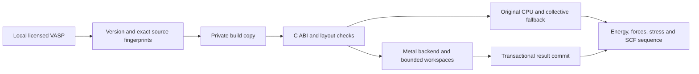

# Technical implementation

## Integration and dispatch

The project provides original Objective-C++ Metal kernels behind C and ISO_C_BINDING interfaces. Local adaptation modifies the licensed private build; no VASP source is distributed. `vasp_metal_abi.mm` interposes selected LP64 BLAS/LAPACK operations and provides FFT, local-Hamiltonian, ownership and nonlocal entry points. Original CPU calculations and collectives remain available when a gate fails or a layout is ineligible.

Backend initialization uses a single shared state/pipeline lifecycle. The allocator registry is constructed before ABI state and its report registration, so state/report teardown occurs before registry teardown. Independent mixed ABI tests exercised projections and FFTs with actual normal process exit. C++/Objective-C++ AddressSanitizer checks did not cover Fortran or GPU memory and cannot exclude every driver defect.

## Double-single arithmetic

A real value is represented as two FP32 components, `x ≈ x_h + x_l`. Error-compensated sums/products preserve low components; complex values carry two such pairs. Explicit compensated `fma` operations are intentional. Safe/precise Metal math and host `-fno-fast-math -ffp-contract=off` prevent implicit reassociation/contraction from invalidating compensation.

Double-single is not hardware FP64 and does not reproduce every FP64 operation bit-for-bit. Its exponent range follows FP32 components. Acceptance requires independent FP64 comparisons and workload-level tests; unsafe/nonfinite results must follow failure paths rather than committing partial outputs. The independent nonlocal tests observed maximum complex difference 1.2422299264342087×10⁻¹³ for their tested inputs. This is a measured result under those conditions, not an all-input error bound.

## Wave basis and ownership

Basis reuse identifies cached data with owner/lifetime and explicit generation transitions. Only changed basis regions are imported; padded ranges and stale generations are tested. The exported wave-basis counters describe this ABI path, not the entire VASP transfer graph. FFT caches preserve allocations but can still upload/download at each ABI invocation.

Full device residency of wavefunctions, PAW and Hamiltonian across all SCF phases is incomplete. Owner/resident/local-Hamiltonian paths still have unresolved wide-index domains. The public package does not claim that all host boundaries have disappeared.

## Factorized nonlocal force/stress projection

For the implemented layout, a projector coefficient has the schematic form

$$
P_{pin}^{(c)}=C_{pt}\sum_g R_{gpt}\,\Phi_{gi}\,\psi_{gn}\,D_g^{(c)}.
$$

Here `p`, `i`, `n` and `c` index the local projector, ion, band and channel; `t` is the ion type. The ordinary channel uses `D_g^(0)=1`; force channel `α` uses `D_g^(α)=m G_(αg)` with the explicit multiplier `m`. `R` is a radial table, `Φ` an atom phase, `ψ` a band wave and `C` a projector factor. The implementation evaluates a common radial–phase–wave product and reduces it in cooperative double-single accumulators. Three force derivative channels multiply the same product by the corresponding reciprocal-coordinate factors and an explicit multiplier. The stress path refreshes the radial table for each required derivative calculation.

Wave/phase generations and scoped ownership govern reuse. Checked size products and 64-bit logical indexing prevent silent dimension-product wraparound in this new projector. Site, band and G windows obey aggregate allocation and individual `maxBufferLength` limits. There is no fixed atom-count cap in this projector; usable size still depends on wave/projector dimensions, host allocations, other VASP arrays and remaining ABI/index limits.

Default nonlocal device workspace strategy is 2 GiB, bounded by the aggregate budget. A full wave cache is retained only when it fits within half that budget. Output buffers on the CPU are an additional transaction cost. Allocation failures, NaNs or late errors do not commit partial host outputs. The independent tests include small 4 KiB windows, padded layouts, generation changes, budget failures and late-failure atomicity.

Native hook eligibility is checked for std complex, non-OpenACC, one global/in-band/inter-band rank, one k-point/spin/spinor and nonspiral data. The launcher explicitly enables `VASP_METAL_NONLOCAL=1`; unsupported layouts keep original CPU projection, distribution and contraction. This scope must not be generalized to MPI, Gamma, SOC spinors or arbitrary PAW layouts.

## Modern-device compilation and shader provenance

`metal_compile_policy.hpp` checks SDK declarations, OS availability, actual Metal family support, unified memory, threadgroup memory and thread limits. The shared-tile path needs eligible Apple-family capabilities; advanced flags do not bypass them. Newer SDK/OS builds may try MSL4, then compatible earlier language versions. Portable requests baseline MSL. Tensor/ANE and new Metal4 encoder kernels are not implemented.

`build-metallib.py` extracts all nine shader parts in their runtime assembly order, preserving double-single pragmas. The manifest records source SHA, compiler arguments, macros, language and deployment target. `metal_library_loader.hpp` checks this contract and library hash. These checks prevent an incompatible shader library silently substituting for the selected kernel set. Runtime-source compilation remains the default installer route.

## Timers and memory accounting

| Quantity | Meaning | Exclusions |
| --- | --- | --- |
| Whole-program elapsed time | External wall time of a fresh process | Not the sum of API timers |
| Source VTIME CPU/wall | Source-stage observations; repeated occurrences summed per run | Parents/children can overlap; wall includes waits |
| API host duration | Time in one backend operation | Can include conversion, submission, wait, overlapping outer stages |
| GPU command duration | Device command-buffer timing | Not execution-unit occupancy or single-process GPU utilization |
| Wait/conversion | Explicit waits and host representation changes | Do not add blindly to API totals |
| WA/nonlocal imports/exports | Logical bytes counted at specific ABI paths | Not physical unified-memory bus transactions or all communication |
| Sampled process RSS | Native process memory observations, sampled every two seconds in reviewed repeats | Unsampled peaks, other processes and global memory excluded |
| Metal allocations | Allocation-time observations for tracked project Metal resources | CPU data, other applications and unobserved driver peaks excluded |
| Planned device workspace | Calculated bounds for an operation | Not actual total allocation or CPU staging |
| CPU transactional staging | Additional host output storage | Missing measured values remain NA |

No table column is an additive partition of total unified memory. AGX IORegistry samples in separate observer work were global/all-users with unknown driver averaging windows; they were not VASP kernel occupancy. Public release figures deliberately avoid treating them as per-process utilization evidence.

## Code map and remaining work

| File | Responsibility |
| --- | --- |
| `Sources/metal_backend.mm` | Backend allocation/cache/dispatch, kernels, timers and projector owner |
| `Sources/vasp_metal_abi.mm` | Native C ABI, guards, fallback and report lifecycle |
| `Sources/metal_wave_owner*.mm` | Owner generations and Davidson reuse |
| `Sources/nonlocal_shader.h` | Factorized cooperative projector and derivatives |
| `Sources/metal_*policy.hpp` | Compile, size/window, eigensolver and memory policies |
| `Sources/metal_library_loader.hpp` | Matching offline shader contract |
| `Scripts/metalvasp.py` | Local diagnostics, exact adapter reconstruction and isolated build |
| `adapters/vasp-6.4.1.json` | Base/output hashes, COPY ranges and original project insertions |
| `Tests/` | Strict/portable numerical, stress and failure tests |

Remaining work includes complete SCF resident lifecycle, owner/resident/Hamiltonian wide indexing, ILP64, distributed FFT/ScaLAPACK, device/MPI communication, other nonlocal layouts, old-OS dependency closure and repeated long-AIMD/HSE/larger-system tests. Scaling until the memory wall is the research objective, not a completed property of this release.
