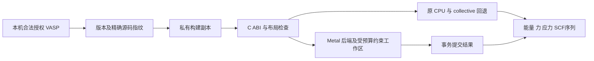

# 技术实现细节

## 集成与分派

本项目通过 C 和 ISO_C_BINDING 接口提供原创 Objective-C++ Metal 内核。本地适配修改私有许可构建，不分发 VASP 源码。`vasp_metal_abi.mm` 接管选定的 LP64 BLAS/LAPACK 操作，并提供 FFT、局域 Hamiltonian、owner 和非局域入口。检查失败或布局不适用时，原 CPU 运算及 collective 仍可使用。

后端采用单一共享 state/pipeline 生命周期。allocator registry 在 ABI state 和报告注册前构造，使 state/report 析构先于 registry。独立混合 ABI 测试实际执行投影/FFT，并要求进程正常退出。C++/Objective-C++ AddressSanitizer 不覆盖 Fortran 或 GPU 内存，也不能排除全部 driver 缺陷。

## 双单精度算术

每个实数表示为两个 FP32 分量，`x ≈ x_h + x_l`。补偿求和/乘积保留低分量；复数使用两对分量。显式补偿 `fma` 是有意操作。Metal safe/precise 数学与 host `-fno-fast-math -ffp-contract=off` 防止隐式重排/收缩破坏补偿。

双单精度不是硬件 FP64，也不逐位复现所有 FP64 运算；指数范围受 FP32 分量约束。接受结果需要独立 FP64 对照及实际工作负载验证；不安全或非有限结果应走失败路径，不提交部分输出。独立非局域测试在指定输入下观测到最大复数差异 1.2422299264342087×10⁻¹³。这是指定条件下的实测，不是任意输入的误差上限。

## 基底复用与 owner

基底缓存由 owner/生命周期及显式代次转换识别，只导入变化区域，并测试 padding 和过时代次。公开波基底计数仅描述此 ABI 路径，不是整个 VASP 传输图。FFT 缓存复用分配，但每次 ABI 调用仍可能上传/下载。

波函数、PAW、Hamiltonian 在所有 SCF 阶段的完整 GPU 常驻生命周期尚未完成。owner/resident/局域 Hamiltonian 中仍有宽索引域未关闭。本包不声称消除了所有 host 边界。

## 因子化非局域力/应力投影

在已实现布局中，投影系数可示意为

$$
P_{pin}^{(c)}=C_{pt}\sum_g R_{gpt}\,\Phi_{gi}\,\psi_{gn}\,D_g^{(c)}.
$$

其中 `p`、`i`、`n`、`c` 分别表示局部投影、原子、band 和通道，`t` 是原子类型。普通通道使用 `D_g^(0)=1`，力通道 `α` 使用 `D_g^(α)=m G_(αg)`，`m` 是显式 multiplier。`R` 是径向表，`Φ` 是原子相位，`ψ` 是 band 波函数，`C` 是投影因子。实现共享径向–相位–波函数乘积，用协作双单精度累加器归约。三个力导数通道对共同乘积施加对应倒易坐标因子和显式 multiplier。应力路线对每次需要的导数计算刷新径向表。

wave/phase 代次和限定范围 owner 控制复用。checked products 与 64 位逻辑索引避免新投影器的维度乘积静默溢出。site、band、G 窗口遵守聚合分配预算和单个 `maxBufferLength`。此新投影器没有固定原子数上限；可计算大小仍依赖波函数/投影维度、host 分配、VASP 其他数组及剩余 ABI/索引限制。

默认非局域设备工作区策略为 2 GiB，并受聚合预算约束。完整 wave cache 只有在半预算内可容纳时才保留。CPU 输出缓冲是额外事务成本。分配失败、NaN 或晚期错误不会提交部分 host 输出。独立测试包含 4 KiB 小窗口、padding、代次变化、预算失败和晚期失败原子性。

原生 hook 检查 std 复数、非 OpenACC、global/in-band/inter-band 单 rank、单 k 点/自旋/spinor 及非螺旋布局。启动器明确启用 `VASP_METAL_NONLOCAL=1`；不支持布局继续使用原 CPU 投影、分发和收缩。不能把此范围推广到 MPI、Gamma、SOC spinor 或任意 PAW 布局。

## 新设备编译与 shader 溯源

`metal_compile_policy.hpp` 检查 SDK 声明、OS availability、真实 Metal family、统一内存、threadgroup 内存及线程限制。共享 tile 路线要求符合条件的 Apple family 能力；advanced 不绕过检查。较新 SDK/OS 可尝试 MSL4，并保留兼容的早期语言。portable 请求基线 MSL。没有 tensor/ANE 或新 Metal4 encoder 内核。

`build-metallib.py` 按运行时拼接顺序提取九个 shader 部分，保留双单精度 pragma。清单记录源码 SHA、编译参数、宏、语言和部署目标。`metal_library_loader.hpp` 检查契约及库 SHA，防止不匹配的 shader 库替代当前内核。安装器默认仍是运行时源码编译。

## 时间与内存口径

| 指标 | 含义 | 不包含/注意 |
| --- | --- | --- |
| 整程序 elapsed | 独立进程外部 wall time | 不是各 API 计时之和 |
| 源码 VTIME CPU/wall | 源阶段观察；每进程重复出现值先求和 | 父/子阶段可重叠，wall 包含等待 |
| API host 时间 | 一个后端操作中的时间 | 可包含转换、提交、等待及外层重叠 |
| GPU command 时间 | 设备 command buffer 计时 | 不是执行单元 occupancy 或单进程 GPU 利用率 |
| wait/conversion | 显式等待和 host 表示转换 | 不能盲目再加到 API 总时间 |
| WA/nonlocal 导入/导出 | 指定 ABI 路径的逻辑字节数 | 不是物理统一内存总线传输或全部通信 |
| RSS 采样 | 已审核重复实验每两秒观测原生进程内存 | 不含未采瞬峰、其他进程或全局内存 |
| Metal 分配 | 已跟踪项目资源在分配时的观察 | 不含 CPU 数据、其他应用及未观察 driver 峰值 |
| 计划设备工作区 | 操作的计算预算 | 不等于实际总分配或 CPU 暂存 |
| CPU 事务暂存 | 额外 host 输出存储 | 未测量值保留 NA |

以上列不是统一内存的可加分区。独立 observer 中 AGX IORegistry 样本是全 GPU/全部用户，driver 平均窗口未知，不是 VASP 内核 occupancy。公开图片不把它们作为单进程利用率证据。

## 代码位置与开放工作

| 文件 | 职责 |
| --- | --- |
| `Sources/metal_backend.mm` | 分配/缓存/分派、内核、计时及投影 owner |
| `Sources/vasp_metal_abi.mm` | 原生 C ABI、guard、回退和报告生命周期 |
| `Sources/metal_wave_owner*.mm` | owner 代次和 Davidson 复用 |
| `Sources/nonlocal_shader.h` | 因子化协作投影和导数 |
| `Sources/metal_*policy.hpp` | 编译、尺寸/窗口、本征求解及内存策略 |
| `Sources/metal_library_loader.hpp` | 匹配离线 shader 契约 |
| `Scripts/metalvasp.py` | 本地诊断、适配器精确重建及隔离构建 |
| `adapters/vasp-6.4.1.json` | 基础/输出 SHA、COPY 范围及项目插入 |
| `Tests/` | 严格/portable 数值、压力及失败测试 |

开放工作包括完整 SCF 常驻生命周期、owner/resident/Hamiltonian 宽索引、ILP64、分布式 FFT/ScaLAPACK、device/MPI 通信、其他非局域布局、旧 OS 依赖闭包及长 AIMD/HSE/更大体系重复实验。持续扩展至内存墙是研究目标，不是此发布版已完成的属性。
